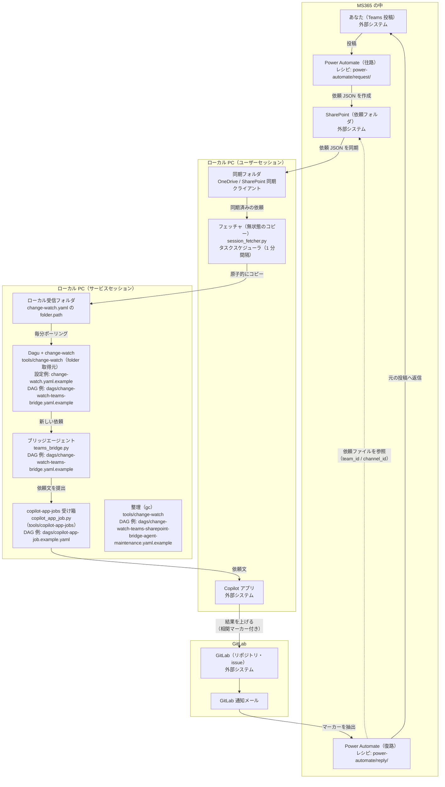

# Teams–SharePoint–Dagu ブリッジのセッション側フェッチャ方式

> 作成 2026-11-23 ／ 状態: 設計案（実環境での確認は §11）

[既存設計（PR #1090）](2026-11-23-teams-sharepoint-bridge-design.md) の変形版として、入口の足回りだけを変える。ID の引き回し（§4）、依頼スキーマ（§5）、失敗時の扱い（§7）、セキュリティ（§8）は既存設計を引き継ぐ。

## 1. 目的と要約

Dagu を Windows サービスで動かすと、ログインユーザーにひもづく SharePoint 同期を利用できない。同期クライアントとフェッチャをユーザーセッションで動かし、同期済みの依頼 JSON をローカル受信フォルダへ運ぶ。サービス側の change-watch は受信フォルダを監視する。

賢さは change-watch 側に寄せ、フェッチャは無状態のコピー役にする。実行間で保存する状態がないため、破損した状態の復旧が不要で、タスクスケジューラの都度実行と相性がよい。更新直後のファイルを待つ settle 判定と重複検出は change-watch の folder source が担い、新規ファイルを `appeared` とし、既存ファイルは内容ハッシュが変わったときに `changed` とする。依頼の二重提出はブリッジ側の処理済み台帳で防ぐ。

## 2. なぜサービス直結が駄目か

Windows サービスは対話セッションから分離されたセッション 0 で、サービスアカウントとして動く。この構成で使う SSO のトークンと OneDrive / SharePoint 同期クライアントは、ログインユーザーの対話セッションにある。サービスの実行アカウントをそのユーザーに変えても対話ログオンは行われないため、ユーザーの SSO は通らず、同期クライアントも起動しない。

## 3. 前提

既存設計 §2 の前提を引き継ぎ、同期先と change-watch の監視先は §7 の受け渡し規約に従う。依頼フォルダを同期している PC には、業務時間中はユーザーがログオンしている。ログオフ中の依頼は SharePoint 側に滞留し、再ログオン後に取り込まれる。

## 4. 役割分担

- MS365（Teams / Power Automate / SharePoint）は投稿から依頼 JSON を作り、GitLab の通知メールを受けて元の投稿に返信する。
- ユーザーセッションでは同期クライアントが依頼を同期し、フェッチャが受信フォルダにコピーする。Copilot アプリの自動実行が受け箱から依頼を拾う。
- サービスセッションでは Dagu が change-watch とブリッジエージェントを起動する。change-watch がローカル受信フォルダを監視し、ブリッジエージェントが検証した依頼を copilot-app-jobs の受け箱へ提出する。
- GitLab は Copilot アプリから結果を受け取り、通知メールを送る。

## 5. 全体の流れ

各ブロックの 2 行目以降にプログラム・ファイルと、対応する DAG 例がある場合はそのファイル名を示す。

1. 利用者が Teams に投稿し、Power Automate の往路フローが SharePoint に `<request_id>.json` を作る。
2. ユーザーセッションの同期クライアントが依頼を同期する。
3. タスクスケジューラがフェッチャを毎分起動し、同期済みの依頼をローカル受信フォルダにコピーする。
4. サービス側の Dagu が毎分、change-watch の `folder` 取得元で受信フォルダをポーリングする。ブリッジエージェントが依頼を検証し、宛先の受け箱に提出する。
5. Copilot アプリが受け箱から依頼を拾い、相関マーカーを添えて GitLab に結果を上げる。
6. GitLab の通知メールを受けた Power Automate の復路フローが、SharePoint の依頼を参照し、元の投稿へ結果とリンクを返信する。
7. サービス側の整理（gc）は毎分の処理と独立して、古い取得結果や状態を片付ける。

## 6. 部品の対応

| 図のブロック | プログラム・ファイル | Dagu 例 | 動く場所 |
|---|---|---|---|
| あなた（Teams 投稿） | 外部システム（Teams） | — | MS365 |
| Power Automate（往路） | レシピ: ブリッジエージェント配下の `power-automate/request/`（トリガー条件とファイル作成。書き方は既存の [`tools/gitlab-mail-teams/power-automate/`](../../tools/gitlab-mail-teams/power-automate/) に揃える） | — | MS365 |
| SharePoint（依頼フォルダ） | 外部システム（SharePoint）。依頼 JSON の置き場所 | — | MS365 |
| Power Automate（復路） | レシピ: ブリッジエージェント配下の `power-automate/reply/`（通知メールのマーカー抽出と返信） | — | MS365 |
| 同期フォルダ | OneDrive / SharePoint 同期クライアントが同期する依頼フォルダ | — | ローカル PC（ユーザーセッション） |
| フェッチャ | `session_fetcher.py`（ブリッジエージェント配下）。無状態で依頼をコピーする | —（タスクスケジューラで起動） | ローカル PC（ユーザーセッション） |
| ローカル受信フォルダ | `change-watch.yaml` の `folder.path` が指す依頼フォルダ | — | ローカル PC（サービスセッション） |
| Dagu + change-watch | 既存の [`tools/change-watch/`](../../tools/change-watch/)（`folder` 取得元）。設定例はブリッジエージェント配下の `change-watch.yaml.example`。`folder.path` をローカル受信フォルダに向ける。Dagu が毎分起動し、`get` で新しい JSON を渡し、処理結果に応じて `commit` する（既存設計 §7） | `dags/change-watch-teams-bridge.yaml.example`（毎分サイクル、必須） | ローカル PC（サービスセッション） |
| ブリッジエージェント | `teams_bridge.py`（`tools/change-watch/agents/teams-sharepoint-bridge-agent/`）。JSON とファイル名を照合し、設定済みの宛先を選ぶ。相関マーカーを付けて提出し、処理済み台帳を持つ | `dags/change-watch-teams-bridge.yaml.example`（毎分サイクル、必須。ブリッジはこの中で動く） | ローカル PC（サービスセッション） |
| copilot-app-jobs 受け箱 | `copilot_app_job.py`（既存の [`tools/copilot-app-jobs/`](../../tools/copilot-app-jobs/)）。対象フォルダの受け箱に依頼文を置く | `dags/copilot-app-job.example.yaml`（任意の参考。原本は `tools/copilot-app-jobs/dags/`） | ローカル PC（サービスセッション） |
| Copilot アプリ | 外部システム。対象フォルダを開いた Copilot アプリの自動実行が受け箱を拾う | — | ローカル PC（ユーザーセッション） |
| GitLab（リポジトリ・issue） | 外部システム（社内 GitLab）。Copilot が結果を issue / コミットとして上げる | — | 社内 GitLab |
| GitLab 通知メール | 外部システム（GitLab が送る通知メール） | — | GitLab が送信し、MS365（Outlook）で受信 |
| 整理（gc） | change-watch の整理（gc）機能。古い取得結果や状態を片付ける | `dags/change-watch-teams-sharepoint-bridge-agent-maintenance.yaml.example`（必須） | ローカル PC（サービスセッション） |

DAG 例はブリッジエージェント配下の `dags/` にそろえてある。設定例の `change-watch.yaml.example` はエージェント直下にある。

## 7. ファイル受け渡しの規約

- コピーは同期フォルダからローカル受信フォルダへの片方向。フェッチャは同期フォルダへの書き戻しや削除を行わない。受信フォルダはサービスアカウントが読める場所に置く。
- 受信フォルダ内に `*.json` に当たらない一時名で書き、`flush` と `os.fsync` の後に `os.replace` で正式名にする。change-watch の `folder` 取得元には書き終えたファイルだけが見える。
- 受信フォルダを監視する folder source は `settle_sec: 0` にする。原子的なリネームで書きかけが見えず、待ち時間を入れると毎分コピーされる新規ファイルが「まだ無い」と判定され続けることがある。同期フォルダを直接監視する直結方式では `settle_sec: 10` を使う。
- folder source の `hash: true` で内容ハッシュを取得し、DAG の `get --watch sha256` で比較する。これにより、同じ内容を毎回コピーしても変化のレコードは出ない。フェッチャは同期フォルダから消えたファイルを受信フォルダから削除しない。
- フェッチャは都度実行する。タスクスケジューラで「ログオン時に開始＋1 分間隔で繰り返し」とし、「既に実行中の場合は新しいインスタンスを開始しない」を選ぶ。

## 8. ID の引き回し

[既存設計 §4](2026-11-23-teams-sharepoint-bridge-design.md#4-id-の引き回し) に従う。フェッチャは依頼の内容を解釈せず、バイト列をそのまま運ぶ。ID の生成や照合は既存の各部品が行う。

## 9. 障害時の挙動

- ログオフ中はフェッチャが実行されない。同期クライアントの停止中は新着依頼が同期されず、フェッチャは同期済みのファイルだけを対象にする。どちらの場合も新着依頼は SharePoint に滞留し、Dagu などのサービス側は動き続ける。次回ログオンで同期とフェッチャが再開すると、同期先に届いた滞留分をファイル名順に運ぶ。依頼は SharePoint に残る。
- 未同期やパス違いで同期フォルダが見えない場合は、標準エラーに理由を出し、終了コード 2 で終了する。
- フェッチャの停止自体は自動検知しない。運用者はタスクスケジューラの実行履歴を確認するか、依頼が届かないことで気づく。
- 個別のコピーが失敗しても残りは続ける。失敗したファイル名と理由を標準出力の結果 JSON に記録し、終了コード 2 を返す。次回実行で同期フォルダにあるファイルを再度コピーする。受信後の失敗時の扱いは既存設計 §7 に従う。

## 10. セキュリティ

- フェッチャはファイルを運ぶだけで、トークンや認証情報を持たない。依頼の検証はブリッジエージェントが行う。
- 受信フォルダへの書き込みはフェッチャを実行するユーザーだけに許可する。サービスアカウントには受信フォルダの読み取りと、別途 change-watch の状態管理に必要な権限を付ける。依頼 JSON の本文は Copilot へのプロンプトになるため、誰でも書けるフォルダには置かない。
- 同期フォルダの権限は SharePoint 側の設定に従う。投稿者の制限などは既存設計 §8 を参照。

## 11. 実環境での確認

実 SharePoint / SSO / タスクスケジューラ / Windows サービスでは未検証。運用開始前に、テスト用チャンネルで次を確かめる。

1. Dagu が Windows サービスで動く状態で、ログオン中の依頼が同期フォルダから受信フォルダを経由して届くこと。
2. ログオフ中も Dagu が動き続け、依頼が SharePoint に滞留し、再ログオン後に取り込みが再開すること。
3. 受信フォルダ側を `settle_sec: 0` と `hash: true` に設定し、毎分のコピーが続いても新規依頼が次の監視で届き、同じ内容の再コピーで変化のレコードが出ないこと。
4. 受信フォルダにフェッチャの実行ユーザーが書き込め、サービスアカウントが読み取れ、ほかの一般ユーザーが書き込めないこと。
