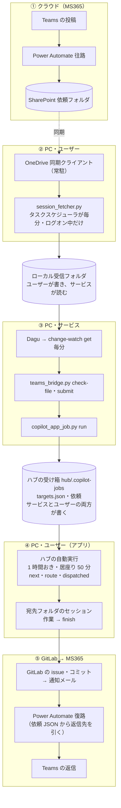

# Teams の依頼を SharePoint 経由で Copilot アプリへ渡す設計

> 作成 2026-11-23 ／ 改訂 2026-11-23（フェッチャ方式を標準に、ハブでの振り分け、振り先の表の統合、実行主体の明記）
> 状態: 実装済み・実環境では未検証（§10）
> 対象: Power Automate / OneDrive 同期クライアント / `session_fetcher.py` / Dagu / change-watch / `teams_bridge.py` /
> copilot-app-jobs / GitHub Copilot デスクトップアプリ / GitLab
> 早見: 段ごとのコマンド・設定ファイル・状態の置き場は [ARCHITECTURE.md](../../tools/change-watch/agents/teams-sharepoint-bridge-agent/ARCHITECTURE.md)、
> 使い方は [README](../../tools/change-watch/agents/teams-sharepoint-bridge-agent/README.md)

## 1. 目的と要約

Teams の対象チャンネルに作業を依頼すると、宛先のフォルダで Copilot アプリのセッションが作業し、GitLab に上げた結果への
リンクが元の投稿への返信で届くようにする。**往路は SharePoint の依頼 JSON、復路は GitLab の通知メール**でつなぎ、依頼から
返信までを `request_id` と Teams の `message_id` で対応づける。

標準の形は次のとおり。

- **取り込み**: SharePoint の依頼フォルダを OneDrive で PC に同期し、**ログインユーザーのタスクスケジューラ**が毎分
  フェッチャを動かして、Dagu（Windows サービス）が読めるローカル受信フォルダへ写す。
- **提出**: Dagu が毎分 change-watch とブリッジ（`teams_bridge.py`）を動かし、依頼を検証して宛先を決め、**ハブの受け箱**に置く。
- **振り分け**: 宛先は規則（投稿の `#名前`・フローの指定・チャンネル・キーワード）で決め、決まらなければ**ハブの Copilot アプリの
  自動実行が候補の説明から選ぶ**。
- **作業**: ハブの自動実行は、宛先のフォルダで Copilot アプリのセッションを起こして依頼を渡し、待たずに次へ進む。同じ宛先へは
  1 件ずつ。セッションは結果を GitLab に上げ、受け箱に終わりを知らせる。
- **返信**: GitLab の通知メールを Power Automate が受け、元の投稿に返信する。

ハブは 1 つ、宛先（作業するフォルダ）はいくつでも。宛先の一覧は、ハブの受け箱に置く `targets.json` 1 つで持つ。

## 2. 前提

- 会社環境でローカルに使えるエージェントは GitHub Copilot アプリか Kiro CLI に限られる。ワークフローは Dagu が受け持ち、
  ネットワーク接続にはプロキシが必須。
- 社内 GitLab と MS365（Teams / SharePoint）はネットワーク上で分離されている。ローカルから Teams に直接投稿する経路はなく、
  自動でメールを送ることもできない。復路で使えるメールは GitLab 自身が出す通知メールに限られる。
- Dagu は Windows サービス（セッション 0・サービスアカウント）で動かす。OneDrive の同期と SSO はログインユーザーの対話
  セッションにしかないので、サービスは同期フォルダを直接読めない。これをつなぐのがフェッチャ（§3.1、詳しい検討は
  [セッション側フェッチャの設計](2026-11-23-teams-bridge-session-fetcher-design.md)）。
- Copilot アプリには外からセッションを始める口が無い。アプリの自動実行（オートメーション）が受け箱を見に来る形にし、
  自動実行は別のローカルフォルダでセッションを起こせる（利用者が実機で確認済み）。
- Microsoft Graph で SharePoint を直接読む案は、認証とプロキシの都合で見送る。

## 3. 全体の構成と実行主体



図の①〜⑤は、動く主体（アカウントと場所）ごとの枠。ユーザーは Windows のログインユーザー、サービスは Dagu の
サービスアカウント。

### 3.1 実行主体の一覧

「誰が起動し、どのアカウントで、いつ動き、何を読み書きするか」。PC の上では、**ログインユーザー**と **Dagu のサービスアカウント**の
2 つの主体が、ローカル受信フォルダとハブの受け箱の 2 か所で受け渡しをする。

| プログラム | 起動するもの | 動くアカウント・場所 | いつ | 読むもの | 書くもの |
|---|---|---|---|---|---|
| Power Automate 往路 | Teams の新しい投稿（トリガー） | クラウド。フローの所有者の接続（Teams・SharePoint） | 投稿のたび（並列度 1） | 投稿・許可リスト | SharePoint の `<request_id>.json` |
| OneDrive 同期クライアント | Windows のログオン | ログインユーザー（対話セッション） | 常駐 | SharePoint の依頼フォルダ | 同期フォルダ |
| `session_fetcher.py fetch-once` | タスクスケジューラ（`session-fetcher-task.xml`） | ログインユーザー（対話セッション）。トークンは持たない | ログオン時から毎分。ログオフ中は動かない。多重起動しない | 同期フォルダ | ローカル受信フォルダ（原子的にコピー） |
| Dagu | Windows のサービス | Dagu のサービスアカウント（セッション 0） | 常駐。ワークフローを毎分起動 | `~/.config/dagu/dags/` のワークフロー | 実行の記録 |
| change-watch（`get`・`commit`） | Dagu のワークフロー `change-watch-teams-bridge` | サービスアカウント | 毎分 | `change-watch.yaml`・ローカル受信フォルダ | change-watch の状態（サービスアカウントの `~/.local/state/…`） |
| `teams_bridge.py`（`check-file`・`submit`・`record-invalid`） | 同上（change-watch のプラグインとして） | サービスアカウント | 毎分。1 回で 1 件 | 依頼 JSON・ハブの `targets.json`・台帳 | 台帳 `submitted.json`・`invalid.jsonl`（サービスアカウントの `~/.local/state/…`） |
| `copilot_app_job.py run` | `teams_bridge.py submit` | サービスアカウント | 提出のたび | ハブの `targets.json` | ハブの受け箱 `pending/` |
| Copilot アプリ（ハブの自動実行） | アプリの自動実行の予定 | ログインユーザー。アプリが開いている間だけ | 1 時間おき。依頼が無ければ 50 分まで待つ | 受け箱 | 受け箱（`next`・`route`・`dispatched` を呼ぶ） |
| `copilot_app_job.py next`・`route`・`dispatched` | ハブの自動実行のセッション | ログインユーザー | 自動実行のたび | 受け箱・`targets.json` | 受け箱（`running/`・`pending/`・`dispatched/`） |
| Copilot アプリ（宛先フォルダのセッション） | ハブの自動実行が起こす | ログインユーザー | 振られたとき | 宛先のフォルダ・依頼文 | 宛先のフォルダ・GitLab（ユーザーの認証で） |
| `copilot_app_job.py finish` | 宛先フォルダのセッション | ログインユーザー | 作業の終わり | — | 受け箱（`done/`・`results/`。宛先が空く） |
| GitLab | — | 社内 GitLab | issue・コミットのたび | — | 通知メール |
| Power Automate 復路 | GitLab の通知メール（Outlook のトリガー） | クラウド。フローの所有者の接続（Outlook・SharePoint・Graph の委任） | 通知のたび | 通知メール・SharePoint の依頼 JSON | Teams の返信 |
| change-watch の整理（`gc`） | Dagu のワークフロー（保守） | サービスアカウント | 毎日 03:17 | — | change-watch の状態 |

ここから決まる運用上の要件:

- **ローカル受信フォルダ**は、ログインユーザーが書けて、サービスアカウントが読めるようにする。
- **ハブの受け箱**は、サービスアカウント（`run` が `pending/` に置く）とログインユーザー（Copilot アプリが取り出し・振り・
  終わりを書く）の**両方が書ける**ようにする。`targets.json` もここにあるので、書けるのはこの 2 つの主体と管理者だけにする。
- `~` はアカウントごとに違う。台帳と change-watch の状態はサービスアカウントのプロファイルの下にある。
- ログオフ中・アプリが閉じている間は、依頼は SharePoint・受信フォルダ・受け箱のどこかで待つ。失われはしないが、返信は遅れる。

## 4. 処理の流れ

1. 利用者が Teams の対象チャンネルに投稿する。往路フローが、許可したチャンネル・投稿者のものだけを `<request_id>.json` に
   して SharePoint の依頼フォルダに作る。
2. OneDrive が同期フォルダに持ってきた依頼を、フェッチャがローカル受信フォルダに写す。
3. Dagu が毎分 `change-watch get` で新しい依頼を 1 件受け取り、`teams_bridge.py check-file` が様式を検証する。
4. `teams_bridge.py submit` が宛先を決め（§5）、依頼文を作って `copilot_app_job.py run --dir <ハブ> --to <宛先>` でハブの受け箱に
   置き、台帳に記録する。最後に `change-watch commit`。
5. ハブの自動実行が `next` で依頼を取り出す。
   - 宛先が決まっていれば、その宛先のフォルダでセッションを起こして依頼を渡し、`dispatched` を呼んで次へ進む。
   - 宛先が `auto` なら、候補（名前と説明）から 1 つ選んで `route` を呼ぶ。依頼は宛先の決まった依頼として待ち行列に戻り、
     次の `next` で振られる。
   - 同じ宛先に振った依頼が終わっていなければ、その宛先の依頼は取り出さない（宛先ごとに 1 件ずつ）。
6. 宛先フォルダのセッションが作業し、宛先の GitLab プロジェクトに issue を作るか、コミットを push する。説明かコミット
   メッセージの最後に「宛先: 名前（理由）」と相関マーカーを置く。最後に `finish` で受け箱に終わりを知らせる。
7. GitLab が通知メールを送る。復路フローがマーカーから両 ID を取り出し、SharePoint の依頼 JSON から `team_id` と `channel_id` を
   引いて、元の投稿へ GitLab へのリンクを返信する。

## 5. 宛先の決め方

`teams_bridge.py submit` が次の順に最初に決まったものを使う。規則で決まるものに AI は使わず、決まらない残りだけを
ハブの自動実行（Copilot）に選ばせる。

| 順 | 決め方 | 決める主体 |
|---|---|---|
| 1 | 投稿の最初の行の `#名前`・`【名前】`（知らない名前なら無視） | ブリッジ |
| 2 | 依頼 JSON の `target`（往路のフローで固定したとき） | ブリッジ |
| 3 | 投稿したチャンネルを受け持つ宛先が 1 つだけ（宛先ごとの `channels`） | ブリッジ |
| 4 | キーワードがいちばん多く当たった宛先が 1 つだけ（宛先ごとの `keywords`） | ブリッジ |
| 5 | 候補の説明（`description`）から選ぶ。3 で複数・4 で同点なら、その中だけが候補 | ハブの自動実行（`route`） |
| 6 | 既定の宛先（`default`） | ブリッジ |

- 決めた宛先と理由は、台帳（`target`・`reason`）と依頼文に残す。依頼文の「宛先: 名前（理由）」は GitLab の本文にも書かせるので、
  Teams の返信から振り先が分かる。外れたら、投稿者が `#宛先名` を付けて投稿し直せば必ずそこへ行く。
- 5 の依頼は `copilot_app_job.py run --to auto --choices-file …` で置く。候補ごとの「GitLab にどう上げるか」の指示と相関マーカーは
  選んだあとに足す（選ぶ前の依頼文には無い）。
- Copilot が選べるのは候補の名前だけで、名前からフォルダへの対応は `targets.json` が持つ。投稿の文が振り先のフォルダを
  決めることはない（§9）。

## 6. 振り先の表（`targets.json`）

ハブの受け箱（`<ハブ>/.copilot-jobs/targets.json`）に 1 つだけ置き、ブリッジと受け箱の両方が読む。置いた受け箱のフォルダが
ハブになる（`hub` は書かなくてよい）。

```json
{
  "default": "app",
  "targets": {
    "app":  {"dir": "C:/work/app",  "gitlab_project": "group/app",  "mode": "issue",
             "description": "業務アプリのコードと不具合", "keywords": ["バグ", "画面"]},
    "docs": {"dir": "C:/work/docs", "gitlab_project": "group/docs", "mode": "commit",
             "description": "手順書とマニュアル", "keywords": ["マニュアル", "手順書"], "channels": ["<チャンネル ID>"]}
  }
}
```

| 項目 | 読むもの | 用途 |
|---|---|---|
| `targets.<名前>.dir` | ブリッジ・受け箱 | 作業するフォルダ。受け箱はここに書かれたフォルダにしか振らない |
| `description` | ブリッジ（候補に載せる）・受け箱（`target list`） | 5 で Copilot が選ぶ材料 |
| `gitlab_project`・`mode` | ブリッジ | 結果を上げる先と、issue かコミットか。どちらも無い宛先は Teams の振り分けに使わない（Teams を通さずに振るための振り先） |
| `keywords`・`channels` | ブリッジ | 3・4 の規則 |
| `default` | ブリッジ | 6 |

宛先を足すときは、このファイルに 1 つ書き足すだけでよい（自動実行は増やさない）。人の手でも `copilot_app_job.py target add` でも
書ける（`target add` はほかの項目を残す）。

## 7. ID の引き回し

1. 起点は Teams の `message_id`。往路フローはそこから決定的に `request_id` を作る（例は `tm-` と `message_id` の SHA-256 の先頭
   16 桁）。ファイル名は `<request_id>.json` とし、同名ファイルが既にあれば作成済みとして扱う。
2. ブリッジは `request_id` を台帳に記録して二重提出を防ぐ。依頼文に次の相関マーカーを実際の ID で埋め込み、GitLab に上げる本文の
   最後にそのまま置くよう指示する。

   ```text
   <!-- teams-bridge:request=<request_id> teams-message=<message_id> -->
   ```

3. 復路フローは通知メールのマーカーから両 ID を取り出し、SharePoint で `<request_id>.json` を引き直して `team_id` と `channel_id` を
   得る。Graph の `POST /teams/{team_id}/channels/{channel_id}/messages/{message_id}/replies` で返信する。

## 8. 依頼ファイルのスキーマ

| 項目 | 必須 | 内容 |
|---|---|---|
| `request_id` | 必須 | 一意な ID。ファイル名 `<request_id>.json` と一致すること |
| `team_id` | 必須 | Teams のチーム ID |
| `channel_id` | 必須 | チャンネル ID（§5 の 3 にも使う） |
| `message_id` | 必須 | 元の投稿のメッセージ ID |
| `author` | 必須 | 投稿者（表示名または UPN） |
| `posted_at` | 必須 | 投稿日時（ISO 8601） |
| `text` | 必須 | 依頼本文（2 万文字まで。§5 の 1・4 にも使う） |
| `target` | 任意 | 宛先名。往路のフローで固定したいときだけ書く（§5 の 2） |

## 9. 失敗とやり直し

| 段 | 状況 | 扱い |
|---|---|---|
| 往路 | 許可リストに無い投稿 | 依頼を作らない |
| 取り込み | ログオフ中・同期の遅れ | 依頼は SharePoint・同期フォルダで待つ。ログオン後にフェッチャが写す |
| 提出 | 様式違反 | 提出せず `invalid.jsonl` に残して `commit`。直すのは投稿側 |
| 提出 | 受け箱へ置けない（宛先が未登録・表が壊れているなど） | `commit` せず、翌分に同じ依頼をやり直す |
| 提出 | 置いたあと、台帳の記録前に停止 | 次の回に、受け箱（`pending`・`running`・`dispatched`・`done`）の相関マーカーから見つけ直して台帳を補う。そのため受け箱の `done/` はすぐに消さない |
| 作業 | アプリが閉じている・PC が寝ている | 受け箱で待つ。次の自動実行で拾う |
| 作業 | `targets.json` が読めない | 振り先のある依頼を取り出さずに待たせる |
| 作業 | 宛先でセッションを起こせない | `dispatched --failed` で失敗として記録し、宛先を空ける |
| 作業 | `finish` が 6 時間来ない | 失敗として記録して宛先を空ける。二重に MR やコミットを作らないよう振り直さない |
| 返信 | 通知メールにマーカーが無い・依頼 JSON が見つからない | 返信しない（少なくとも返信が済むまで依頼ファイルは残す） |

## 10. セキュリティ

- `text` はそのまま Copilot へのプロンプトになる。往路フローのトリガー条件で、対象チャンネルと投稿者を許可リストに絞る。
- 依頼本文と依頼者名に含まれる `teams-bridge:` は、ブリッジが全角のコロンにして、利用者がマーカーを作れないようにする。
- 振り先は閉じている。ブリッジは `targets.json` の名前からフォルダを決め、`route` は候補にない名前を受け付けず、受け箱は
  `targets.json` に書かれたフォルダにしか振らない。投稿の文で任意のフォルダにセッションを起こすことはできない。
- ハブの受け箱（`targets.json` を含む）に書けるのは、サービスアカウント・ログインユーザー・管理者だけにする。ここに書ければ、
  登録したフォルダでのセッションを起こせる。
- GitLab に書き込む権限は、Copilot アプリを使うユーザーの認証に委ねる。ブリッジとフェッチャはトークンを持たない。

## 11. ハブを使わない形

`targets.json` を受け箱の外（たとえば `~/.config/change-watch/teams-sharepoint-bridge-agent/`）に置き、`hub` も書かなければ、
ブリッジは宛先のフォルダの受け箱に直接置く。宛先ごとに自動実行を作り、そのセッションが自分で作業する（`done` で終える）。
§5 の 5（Copilot が選ぶ）は使えず、既定の宛先になる。初期の設計はこの形だった。

## 12. 実環境での確認

実 SharePoint / Teams / Power Automate / GitLab / Copilot アプリでは未検証。運用開始前に、テスト用のチャンネルと GitLab
プロジェクトで次を確かめる。

1. 許可した投稿が依頼 JSON になり、往路フローを再実行しても同名のファイルが 1 件だけ残ること。対象外からは作られないこと。
2. フェッチャがログオン中に毎分動き、サービスアカウントが受信フォルダを読めること。ハブの受け箱に、サービスアカウントと
   ログインユーザーの両方が書けること。
3. `#宛先名` の投稿がその宛先のフォルダで作業されること。規則で決まらない投稿で、ハブの自動実行が候補を選んで `route` を
   呼び、選んだ宛先で作業されること。同じ宛先への 2 件目が、1 件目の `finish` まで待つこと。
4. issue 作成とコミットのそれぞれで通知が届き、マーカーを抽出して元の投稿に GitLab のリンク付きで返信できること。

## 経緯

- 初版は、同期フォルダを Dagu が直接読む形と、宛先ごとに Copilot アプリの自動実行を置く形だった（§11）。
- Dagu をサービスで動かすと同期フォルダを読めないため、セッション側フェッチャを足し、標準にした
  （[検討の記録](2026-11-23-teams-bridge-session-fetcher-design.md)）。
- 自動実行がほかのフォルダでセッションを起こせることが分かったため、ハブで 1 つだけ動かして宛先に振る形にし、宛先を投稿の
  内容で決める仕組み（規則 → Copilot）を足した。振り先の表は `targets.json` 1 つにまとめた。
- 入口の別案（PR #1079 の、GitLab のハブ issue を経由する形）は採らなかった。復路を GitLab 通知メールで受ける考え方は引き継いでいる。
