# Teams の依頼を SharePoint 経由で Copilot アプリへ渡す設計

> 作成 2026-11-23 ／ 状態: 設計案（実環境での検証は §9）
> 対象: Dagu / change-watch / copilot-app-jobs / Power Automate

## 1. 目的と要約

Teams の対象チャンネルに作業を依頼すると、対象フォルダの Copilot アプリが作業し、GitLab に上げた結果へのリンクが元の投稿への返信で届くようにする。**往路は SharePoint の依頼 JSON、復路は GitLab の通知メール**でつなぐ。依頼から返信までを `request_id` と Teams の `message_id` で対応づける。

## 2. 前提

- 会社環境でローカルに使えるエージェントは GitHub Copilot アプリか Kiro CLI に限られる。ワークフロー処理は Dagu が受け持ち、ネットワーク接続にはプロキシが必須となる。
- 社内 GitLab と MS365（Teams / SharePoint）はネットワーク上で分離されている。ローカルから Teams に直接投稿する経路はなく、自動でメールを送ることもできない。復路で使えるメールは GitLab 自身が出す通知メールに限られる。
- SharePoint の依頼フォルダは、OneDrive / SharePoint の同期クライアント、またはネットワークフォルダを介して、Dagu が動く PC のローカルパスに同期されている前提とする。change-watch の `folder` 取得元が見るのはこのローカルパスで、同期が SharePoint との橋になる。同期の遅れを見込み、更新直後のファイルを拾わないよう `settle_sec` は長め（例 10 秒）にする。
- Microsoft Graph API で SharePoint を直接見る取得元を change-watch に足す案は、認証とプロキシの都合で今回は見送る。将来、同期を使えない環境での選択肢とする。

### 2.1 PR #1079 との関係

[PR #1079](https://github.com/ynitto/sandbox/pull/1079) の `docs/designs/teams-dagu-trigger-design.md` で検討した入口の一つは、Power Automate がメール経由で GitLab のハブ issue にコメントする形だった。同文書の後続版では、GitLab の受信メールが使えない前提で、手元の Outlook を経由する案を選んでいる。本設計では利用者が選んだ SharePoint の依頼 JSON を入口にし、ハブ issue を経由しない。復路はどちらも GitLab 通知メールを Power Automate が受け取り、Teams の元の投稿に返信する考え方を引き継ぐ。

## 3. 全体の流れ

```mermaid
flowchart LR
    teams["あなた（Teams 投稿）"]
    outbound["Power Automate（往路・ファイル作成）"]
    sharepoint["SharePoint（依頼フォルダ）"]
    dagu["Dagu + change-watch（folder 取得元・毎分ポーリング）"]
    bridge["ブリッジエージェント"]
    inbox["copilot-app-jobs 受け箱"]
    copilot["Copilot アプリ"]
    gitlab["GitLab（リポジトリ・issue）"]
    mail["GitLab 通知メール"]
    inbound["Power Automate（復路・返信投稿）"]

    teams -->|"投稿本文と message_id"| outbound
    outbound -->|"message_id から request_id を生成し、両 ID を含む request_id.json を作成"| sharepoint
    sharepoint -->|"同期した request_id.json をローカルパスで検知"| dagu
    dagu -->|"新しい依頼ファイル（request_id と message_id）"| bridge
    bridge -->|"両 ID の相関マーカーを含む依頼文を提出"| inbox
    inbox -->|"対象フォルダの依頼文と相関マーカー"| copilot
    copilot -->|"issue の説明またはコミットメッセージに両 ID のマーカー"| gitlab
    gitlab -->|"通知本文に両 ID のマーカー、通知に結果リンク"| mail
    mail -->|"マーカーから request_id と message_id を抽出"| inbound
    inbound -->|"request_id で依頼ファイルを検索"| sharepoint
    sharepoint -->|"依頼ファイルから team_id と channel_id を取得"| inbound
    inbound -->|"message_id の投稿へ結果リンク付きで返信"| teams
```



1. 利用者が Teams の対象チャンネルに投稿する。
2. Power Automate の往路フローが投稿を受け取り、SharePoint の依頼フォルダに `<request_id>.json` を作成する。
3. Dagu が毎分、change-watch の `folder` 取得元で同期先をポーリングし、新しい依頼ファイルを検知する。
4. ブリッジエージェントが依頼を検証し、`target` に対応するフォルダの Copilot アプリへ copilot-app-jobs 経由で提出する。
5. Copilot アプリが作業し、対象 GitLab プロジェクトへ自分で issue を作成するか、コミットをプッシュする。issue の説明またはコミットメッセージには相関マーカーを必ず残す。
6. GitLab が通知メールを送る。Power Automate の復路フローがマーカーから両 ID を取り出し、元の投稿への返信として結果と GitLab へのリンクを投稿する。

## 4. ID の引き回し

1. 起点は Teams の `message_id`。往路フローはそこから決定的に `request_id` を作る（例は `tm-` と `message_id` の SHA-256 の先頭 16 桁をつないだもの）。ファイル名は `<request_id>.json` とし、同名ファイルが既にあれば作成済みとして扱う。同じ投稿でフローが再実行されても、ID とファイル名は同じになり、ファイルは 1 件だけになる。
2. ブリッジは `request_id` を処理済み台帳に記録し、再取得時は台帳を見て二重提出を防ぐ。Copilot への依頼文には下の相関マーカーを実際の ID で埋め込み、GitLab に上げる本文にもそのまま含めるよう指示する。

   ```text
   <!-- teams-bridge:request=<request_id> teams-message=<message_id> -->
   ```

3. GitLab の通知メール本文に現れたマーカーから、復路フローが `request_id` と `message_id` を抽出する。SharePoint で `<request_id>.json` を引き直して `team_id` と `channel_id` を得る。Graph の `POST /teams/{team_id}/channels/{channel_id}/messages/{message_id}/replies` で元の投稿に返信する。

## 5. 依頼ファイルのスキーマ

| 項目 | 必須 | 内容 |
|---|---|---|
| `request_id` | 必須 | 一意な ID。ファイル名 `<request_id>.json` と一致すること |
| `team_id` | 必須 | Teams のチーム ID |
| `channel_id` | 必須 | チャンネル ID |
| `message_id` | 必須 | 元の投稿のメッセージ ID |
| `author` | 必須 | 投稿者（表示名または UPN） |
| `posted_at` | 必須 | 投稿日時（ISO 8601） |
| `text` | 必須 | 依頼本文 |
| `target` | 任意 | 宛先（対象フォルダと GitLab プロジェクトの組を指す名前）。省略時は既定の宛先 |

## 6. 部品の対応

| 部品 | 置き場所 | 受け持ち |
|---|---|---|
| Dagu / change-watch | 既存の [`tools/change-watch/`](../../tools/change-watch/) | Dagu が毎分起動し、`folder` 取得元の `get` で新しい JSON を渡す。処理結果に応じて `commit` する（§7） |
| ブリッジエージェント | 新規の `tools/change-watch/agents/teams-sharepoint-bridge-agent/` | JSON とファイル名を照合し、設定済みの宛先を選ぶ。相関マーカーを付けて提出し、処理済み台帳を持つ |
| copilot-app-jobs | 既存の [`tools/copilot-app-jobs/`](../../tools/copilot-app-jobs/) | 対象フォルダの受け箱に依頼文を置く。対象フォルダを開いた Copilot アプリの自動実行が拾う |
| Power Automate のレシピ | ブリッジエージェント配下の `power-automate/` に置く | 往路のトリガー条件とファイル作成、復路の通知メールの抽出と返信を記載する。書き方は既存の [`tools/gitlab-mail-teams/power-automate/`](../../tools/gitlab-mail-teams/power-automate/) に揃える |
| Dagu の DAG 例一式 | ブリッジエージェント配下の `dags/` | このソリューションを動かすのに要る DAG 例を全部そろえた場所。ブリッジの毎分サイクルと整理（gc）は必須、copilot-app-jobs の Dagu 例は任意の参考。原本は各ツールの置き場所にあり、ここはコピー（ずれはエージェントのテストで検知する） |

## 7. 失敗時の扱い

| 状況 | 扱い |
|---|---|
| 依頼ファイルが様式違反 | 提出せず、ファイル名と違反内容をログに残して `commit` する。そのファイルの処理はそこで終え、修正は投稿側が行う |
| Copilot への提出が失敗 | `commit` せず、翌分のサイクルで同じファイルを再取得して再試行する |
| 提出成功後、`commit` 前に停止 | 台帳に提出済みの `request_id` があれば、再提出せず `commit` する |
| 受け箱のジョブファイルが台帳の記録前に消える | 再試行で二重提出が起こりうるため、受け箱の `done/` にあるジョブファイルはすぐに削除しない |
| 依頼本文や依頼者名にマーカーの形が含まれる | ブリッジが `teams-bridge:` のコロンを全角にして無効化する。正規のマーカーは GitLab 側の本文の最後に置き、復路フローは最後の出現を使う |
| GitLab 通知メールにマーカーが無い | 復路フローの対象外として無視する |
| 対応する依頼ファイルが見つからない | 削除などで `team_id` と `channel_id` を引けなければ返信できない。少なくとも返信が済むまでは依頼ファイルを残す |

提出が成功した時点で台帳に永続化し、その後に change-watch の `commit` を行う。受け箱への書き込み直後、台帳の更新前に停止する場合もあるため、実装時は `request_id` で提出済みのジョブを再照合できるようにする。受け箱に残っている間だけでなく、Copilot が受け取った後も照合できることを確認する。

## 8. セキュリティ注意

- `text` はそのまま Copilot へのプロンプトになる。Power Automate の往路フローのトリガー条件で、対象チャンネルと投稿者を必ず許可リストに絞る。誰でも書けるチャンネルは対象にしない。
- ブリッジは依頼本文を Copilot への依頼文として扱う。実行するのは copilot-app-jobs への決まった提出手順だけとし、本文を任意のコマンドとして実行しない。`target` は設定済みの宛先名から解決する。
- GitLab に書き込む権限は、Copilot アプリで開いたプロジェクトとその環境の認証に委ねる。ブリッジは GitLab のトークンを持たない。

## 9. 実環境での確認

実 SharePoint / 実 Teams / 実 Power Automate / 実 GitLab では未検証。運用開始前に、テスト用チャンネルと GitLab プロジェクトで次を確かめる。

1. 許可した投稿が依頼 JSON になり、同じ投稿で往路フローを再実行しても同名のファイルが 1 件だけ残ること。対象外のチャンネルや投稿者からは依頼ファイルが作られないこと。
2. 同期先に届いたファイルを毎分の Dagu が拾い、`settle_sec` の設定で書き込み途中のファイルを処理しないこと。様式違反、提出失敗、提出直後の停止を試し、§7 のログ、再試行、二重提出の防止を確認する。
3. issue 作成とコミットのそれぞれで通知が届き、実際のメール本文から HTML コメント形式のマーカーを抽出できること。復路フローが必要な Graph の権限を持ち、元の投稿に GitLab リンク付きで返信できること。マーカーの無いメールと依頼ファイルが無い場合の挙動も確かめる。
