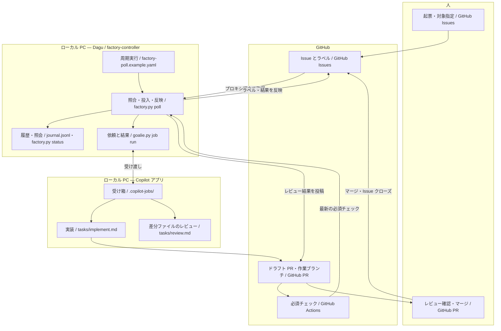

# 社内ソフトウェアファクトリーの設計

> 作成 2026-11-26 ／ 状態：設計案  
> 導入手順は [ソフトウェアファクトリーの導入手順](./2026-11-26-software-factory-introduction.md) を参照。

## TL;DR

- GitHub Issues の `factory` を入口に、ローカル PC の Dagu が factory-controller を定期実行する。Copilot アプリへの実装・レビュー依頼は goalie job で渡す。
- GitHub Actions の必須チェックを通過した差分だけをローカル PC で AI レビューする。マージは人が判断する。
- 現在状態は GitHub のラベル、遷移履歴と二重投入防止の記録は `journal.jsonl` に残す。初期運用は 1 リポジトリ、低リスクな Issue、同時実行 1 件から始める。

## 1. 背景と定義

ソフトウェアファクトリーとは「チケット・PR・スケジュールを入力として、マージ済みのコードを生産するエージェントの仕組み」。Matt Pocock の用語集を社内環境向けに具体化し、繰り返し行う仕事をタスク、その一回の実行を run と呼ぶ。[software-factory 用語集](https://github.com/mattpocock/skills/blob/5863806dd4e15c63174bee4e7515a4256792ecfa/skills/in-progress/software-factory/SKILL.md)

各 run は人の介入を待たずに終わる。人の修正やマージは後続のポーリングで検出する。実行環境は使い捨てとし、業務状態はチケットトラッカー・Git ホスト・オーケストレーター（controller のジャーナルを含む）にのみ残す。アプリで開くクローンは再利用できる作業場所とし、run ごとの作業状態・入力ファイルは結果確定後に片付ける。既製のサービスを使い、ファクトリー固有の仕事はタスク定義に表す。

## 2. 前提と制約

- 社内運用を対象とする。Git ホストは GitHub、CI は GitHub Actions。必須チェックを設定し、マージは人が行う。自動マージは行わない。
- Dagu と factory-controller はローカル PC で動き、社内プロキシ経由で GitHub API をポーリングする。
- ランナーはローカル PC の GitHub Copilot デスクトップアプリ。goalie job の受け箱を使う。AI レビューの差分解析もこの PC で行い、GitHub Actions 等のクラウド CI には載せない。Kiro CLI は将来の代替候補。
- PR #1123（goalie 統合）はマージ済みで、`tools/goalie/` は main に存在する。残る未検証範囲は実 GitHub・実 Copilot アプリ・実 Dagu での動作のみ。factory-controller とその資産は本書で定義する実装予定の構成。

## 3. 構成（パーツ割り当て）

| パーツ | 担当 |
| --- | --- |
| チケットトラッカー | GitHub Issues。人が `factory` を付けて対象を指定 |
| チケットソース | 初期は手動起票のみ |
| Git ホスト | GitHub。作業ブランチと PR を保存 |
| CI | GitHub Actions。保護対象ブランチの必須チェックを実行 |
| オーケストレーター | Dagu が周期を管理し、factory-controller が対象と遷移を判定 |
| ランナー | Copilot アプリ。goalie job で依頼と結果を受け渡す |
| オブザーバビリティ | DB を持たず、Issue・PR・CI の状態とジャーナルから `factory.py status` が算出 |

## 4. 全体図



## 5. 状態遷移設計

Issue の `factory` は人が付ける対象ラベル。controller が付け替える進捗ラベルは原則 1 個とする。PR の `factory` はファクトリーが作ったことを示す印で、進捗ラベルは Issue にだけ付ける。CI 待ちと人のマージ待ちはそれぞれ `factory:pr-open` と `factory:reviewed` のまま、PR とチェックの状況で判別する。

| 遷移元 | きっかけ | 遷移先 | 誰が動かすか |
| --- | --- | --- | --- |
| 未指定 | 開いている Issue に `factory` を付ける | 実装待ち | 人 |
| 実装待ち | 投入枠を確保して依頼を出す | `factory:implementing` | controller |
| `factory:implementing` | 指定ブランチ・Issue リンク・`factory` が揃ったドラフト PR を確認 | `factory:pr-open`、CI 待ち | controller |
| `factory:pr-open` | 最新の PR リビジョンで必須チェックがすべて通過し、レビューが有効 | `factory:in-review` | controller |
| `factory:in-review` | 同じリビジョンのレビュー結果を PR に報告し、重大な指摘がない | `factory:reviewed`、人のマージ待ち | controller |
| `factory:reviewed`、またはレビューの重大指摘で `factory:failed` | 未解決の job がなく、修正コミットでレビュー対象のリビジョンが変わる | `factory:pr-open`、CI 待ち | controller |
| 人のマージ待ち | ドラフト解除、必要な確認と承認、マージ | マージ済み・Issue クローズ | 人。Issue は既定ブランチへのマージ時のクローズリンクでも閉じる |
| 実装中・レビュー中 | job 終了コード 3。依頼は取り下げ済み | 実装待ち・CI 確認待ちに戻り、次の poll で再判定 | controller |
| 実行中・CI 待ち | 依頼失敗、終了コード 4、CI 失敗、重大な指摘など | `factory:failed` | controller が理由をコメントとジャーナルに記録 |

コード 2 はコントローラーの設定エラーとして扱い、新規投入を保留して人に通知する。レビュー中にリビジョンが変わった場合は古い結果を採用せず、新しいリビジョンの CI 待ちへ戻す。現在状態の正は GitHub のラベル。遷移履歴と冪等性キーはジャーナルに残し、コメントは人への報告に使う。マージ済みとクローズ済みは GitHub の PR・Issue の状態で確認する。

## 6. タスク定義（Phase 1）

### 実装タスク

- 入力は Issue 本文・ラベルと対象リポジトリの作業フォルダ `<work_root>/<repo名>/`。controller は `tasks/implement.md` に Issue の内容をデータとして差し込み、UTF-8 の依頼ファイルを生成する。
- 成果物は `factory/issue-<Issue番号>` 上のコミットとドラフト PR。例は `factory/issue-123`。PR に `factory` と Issue を参照するクローズリンク（例 `Closes #123`）を付ける。job の成功報告を受けた後、controller が GitHub 上で成果物を確認して終了とする。
- アプリは変更・検証・ローカルコミットを行う。成功報告後、controller が検証済みの作業ブランチを push し、ドラフト PR を作る。作業ツリーが想定状態と違う場合や既存 PR と対応しない場合は上書きせず、確認が必要な理由を報告する。

```text
python goalie.py job run --dir <作業フォルダ> --prompt-file <実装依頼ファイル> --name factory-impl-<Issue番号> --timeout <job_timeout_sec>
```

### レビュータスク

controller が `gh pr diff` 等で最新の差分を作業フォルダ内の一時ファイルに保存し、取得前後の PR リビジョンが同じことを確かめる。`tasks/review.md` で、その差分ファイルだけを読み、リポジトリ全体の探索やコード変更を行わないよう明示する。Copilot アプリは結果を goalie に返し、controller がリビジョンと必須チェックを再照合したうえで PR にレビューコメントを投稿する。[GitHub CLI の gh pr diff](https://cli.github.com/manual/gh_pr_diff)

```text
python goalie.py job run --dir <作業フォルダ> --prompt-file <レビュー依頼ファイル> --name factory-review-<PR番号> --timeout <job_timeout_sec>
```

結果は対象リビジョン、結論、指摘の一覧とする。各指摘に「重要度｜差分のファイルと行｜根拠と推奨対応」を付ける。指摘がなければその旨を記載する。

| 重要度 | 扱い |
| --- | --- |
| 重大 | マージ前に直すべき。Phase 1 では人が対応し、修正後に CI とレビューをやり直す |
| 指摘 | 直すのが望ましい。対応するかは人が判断 |
| 提案 | 任意。今回の変更に含めるかは人が判断 |

### goalie job の結果

| 終了コード | controller の扱い |
| --- | --- |
| 0 | 成功報告。実装成果物またはレビュー結果を検証して反映 |
| 1 | アプリが失敗を報告。依頼内容の問題として `factory:failed` にし、理由を残す |
| 2 | 使い方の誤り。設定ミスとして controller が停止し、Dagu の失敗ログを通じて運用者に通知。修正までは新規投入を保留 |
| 3 | アプリが時間内に拾わず、依頼は取り下げ済み。次回 poll で条件を再判定して再投入可 |
| 4 | アプリが取りかかり、時間内に完了しなかった。依頼は残るため `factory:failed` にし、再投入せず人の確認を待つ |

同一作業フォルダでは 1 件ずつ処理される。並行させる場合は作業フォルダを分け、それぞれをアプリで開いて自動実行を用意する。詳細は [goalie README](../../tools/goalie/README.md) を参照。

## 7. ブレーキ（品質の担保）

1. **必須チェック。** 最新のリビジョンで GitHub Actions の必須チェックがすべて通るまでレビューしない。結果が未取得・保留なら待機。失敗は Phase 1 では `factory:failed`、Phase 2 以降は条件を満たす失敗だけ修正タスクへ回す。
2. **ローカル AI レビュー。** 差分だけを解析し、根拠と重要度を PR に残す。
3. **人のマージ判断。** 人がドラフトを解除し、差分と最新の CI・レビューを確認してマージする。

Start slow の初期対象は 1 リポジトリの文書修正など低リスクな Issue。強いブレーキを維持した状態で実運転を確かめる。

## 8. factory-controller の設計

`factory.py poll` は設定を検証し、プロキシ経由で対象リポジトリをポーリングする。現在状態とジャーナルを照合して遷移を判定し、goalie job を投入し、結果の回収・GitHub への反映・ラベル付け替え・ジャーナル記録を行って終了する。処理対象がなくてもサイクルの結果を記録する。`factory.py status` は読み取り専用で、現在のラベル、PR・CI の状態、直近の実行と保留理由を表示する。

作業ルート単位で OS の排他ロックを取り、Dagu と手動起動の重複を防ぐ。投入前に対象（リポジトリと Issue/PR 番号）×遷移×実行 ID を永続化する。さらに同じ対象・遷移・入力リビジョンに未解決または成功済みの実行があれば、新しい実行 ID でも投入を抑止する。コード 3 の記録がある場合は、次回 poll で条件を確認し、新しい実行 ID を割り当てられる。コード 4 や投入前後で中断して結果が不明な場合は、受け箱・既存ブランチ・PR を照合するまで再投入しない。コード 4 で残った依頼も同時実行枠と作業フォルダを占有する。

結果回収後に GitHub 書き込みが失敗した場合は、保存した成果物の参照と GitHub の現状を照合し、未反映の更新から再開する。PR は作業ブランチと Issue リンク、レビュー報告は対象リビジョンと実行 ID で重複を検出する。書き込み前には対象ラベルと PR の状態を再取得する。

ジャーナルは 1 行 1 JSON。時刻、リポジトリ、対象種別・番号、遷移、入力リビジョン、実行 ID、job 名、イベント、終了コード、理由、成果物の参照を記録する。トークン、依頼文、差分本文は記録しない。

```jsonl
{"at":"2026-11-26T09:00:00Z","repository":"internal-org/internal-repo","target_type":"issue","target":123,"transition":"implement","input_revision":"2026-11-26T08:55:00Z","run_id":"a1","job_name":"factory-impl-123","event":"job_finished","exit_code":3,"reason":"pickup_timeout","pr":null}
```

設定ファイル `tools/software-factory/factory.json` の例。

```json
{
  "repositories": ["internal-org/internal-repo"],
  "label": "factory",
  "poll_interval_sec": 300,
  "max_concurrent": 1,
  "work_root": "C:/work/factory",
  "goalie_py": "C:/tools/goalie/goalie.py",
  "job_timeout_sec": 7200,
  "review": {"enabled": true},
  "journal": "C:/work/factory/journal.jsonl"
}
```

| 項目 | 意味 |
| --- | --- |
| `repositories` | 対象の `owner/repo` の配列 |
| `label` | 人が対象 Issue に付けるラベル。初期運用は `factory` |
| `poll_interval_sec` | Dagu の起動周期。既定 300 秒。変更時は DAG のスケジュールも合わせる |
| `max_concurrent` | 同時に流す実行の上限。初期値 1。同一作業フォルダは常に上限 1 |
| `work_root` | クローン置き場。作業フォルダは `<work_root>/<repo名>/`。同名リポジトリが衝突する構成は設定時に拒否 |
| `goalie_py` | 配置済みの `goalie.py` のパス |
| `job_timeout_sec` | goalie job の待ち時間。アプリ起動間隔と作業時間の和より長く取る |
| `review.enabled` | レビューの新規投入を有効にする |
| `journal` | `work_root` 配下の `journal.jsonl` のパス |

## 9. Dagu の DAG 例

`tools/software-factory/dags/factory-poll.example.yaml` は `factory.py poll` を `poll_interval_sec` に合わせて起動する雛形。300 秒は 5 分の cron に対応する。パスを環境に合わせ、Dagu の自動再試行は設定せずに controller の照合に任せる。controller は常駐しない。前回の実行が続いている場合は次の実行を重ねない。[Dagu のスケジュール仕様](https://docs.dagu.sh/writing-workflows/scheduling)

```yaml
description: "ソフトウェアファクトリーを 5 分おきにポーリングする"
schedule: "*/5 * * * *"
type: graph
steps:
  - name: poll
    action: exec
    with:
      command: python
      args:
        - "C:/tools/software-factory/factory.py"
        - "poll"
```

## 10. セキュリティ

- トークンは対象リポジトリに限定し、Issue のラベル・コメント、PR の作成・報告、ブランチの push、CI 状態の参照に必要な範囲のみ付与する。認証情報は設定・ジャーナル・プロンプトに置かず、公開操作は controller が担当する。通信は社内プロキシ経由とする。
- 受け箱に置かれた文はそのまま実行される。OS のアクセス権で書き込みを依頼者と実行に必要な仕組みに限定する。Issue 本文・差分は入力データとして扱い、タスクの権限を変更する指示として使わない。
- `python goalie.py hooks --dir <フォルダ>` で `.github/hooks/goalie.json`（`preToolUse`）を生成し、`policy.json` の `tools` と照合して作業フォルダ外への書き込み等を止める。実装に必要なローカルコマンドだけを許可し、フックが効くことを導入時に検証する。
- 差分解析はローカル PC の Copilot アプリで実行し、差分ファイルをクラウド CI に渡さない。マージは人の資格情報とブランチ保護の下で行う。

## 11. 段階導入の概要

- Phase 0 は対象リポジトリとローカル環境を準備し、接続を確認する。
- Phase 1 は実装とレビューを運用する。
- Phase 2 は修正タスクを追加する。`"fix": {"enabled": true}` で有効化し、レビュー指摘に対応する修正コミットを既存 PR に追加する。最新コミットで CI とレビューをやり直す。対応対象と試行上限を決め、解決しなければ人に引き継ぐ。
- Phase 3 は振り返りタスク（Retro）を追加する。マージ済み PR の指摘を集め、スキルやマニュアルの改善を提案する。提案の採否と反映は人が判断する。

各段階の完了条件と停止手順は [導入手順書](./2026-11-26-software-factory-introduction.md) を参照。

## 12. ファイル配置

```text
tools/software-factory/
├── factory.py                     # poll / status
├── factory.json                   # factory.py と同じディレクトリから読み込む
├── dags/
│   └── factory-poll.example.yaml   # Dagu に配置する雛形
└── tasks/
    ├── implement.md               # 実装タスクのプロンプト雛形
    └── review.md                  # レビュータスクのプロンプト雛形
```

`journal.jsonl` は設定された作業ルート配下に置く。各クローンの `.copilot-jobs/` はランナーの受け箱として使う。

## 13. テスト計画

GitHub API はフェイクに差し替える。`gh` の呼び出しは入出力を抽象化して差し替え可能にし、goalie 起動と時刻もテスト用に制御する。

- ラベル付与からドラフト PR、必須チェック、ローカルレビュー、人のマージ・Issue クローズを検出するまでの遷移。
- 二重起動、投入の前後での中断、PR 作成やレビュー投稿の応答喪失でも同じ依頼を二重投入しないこと。
- コード 3 は次の poll で再投入可能で、コード 4 は依頼を残して再投入しないこと。コード 1 は失敗記録、コード 2 は新規投入保留に進むこと。
- 必須チェックが未完了・失敗・旧リビジョンの PR がレビューに進まないこと。レビュー中に更新されたリビジョンに旧結果を付けないこと。
- 対象ラベル除去や `review.enabled` 無効化で新規投入が止まり、進行中の結果を再開時に照合できること。

## 14. 未検証事項・未決事項

- 実連携の未検証範囲は、実 GitHub のトークン・プロキシと PR/CI 遷移、実 Copilot アプリの自動実行・フック・結果回収、実 Dagu のスケジュール・停止・重複起動時の動作。
- レビュー報告の形式は未決。Phase 1 の手順例は通常コメントを想定し、GitHub の PR レビュー（Request changes 等）を採用するかは実連携時に決める。
- `factory:failed` からの再開操作の詳細、複数リポジトリ展開時の優先順位、Phase 2 の修正対象と試行上限は未決。失敗した依頼の状態確認までは再投入を保留する。
