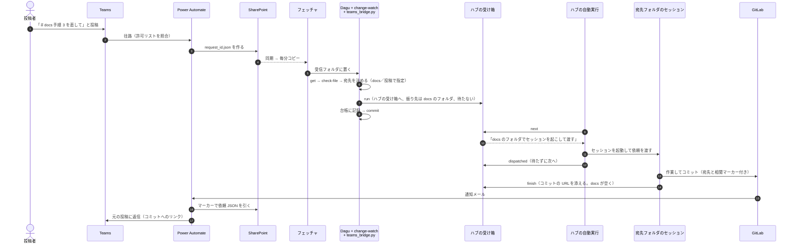

# 構成と流れ — Teams の投稿から Copilot アプリで作業し、Teams に返信するまで

Teams に投稿された依頼を、宛先のフォルダで Copilot アプリのセッションに作業させ、結果を GitLab に上げて、元の投稿へ
リンクを返信するまでの全体を 1 枚にまとめる。どのソフトが、どのプログラムを、どの設定ファイルで呼び、何をするかを
段ごとに書く。主に書くのは、ハブ（`targets.json` を置いた受け箱のフォルダ）を使う形。ハブを使わない形との違いは
[§6](#6-ハブを使わない形) にある。

- 設計: [Teams–SharePoint ブリッジ](../../../../docs/plans/2026-11-23-teams-sharepoint-bridge-design.md)・
  [セッション側フェッチャ](../../../../docs/plans/2026-11-23-teams-bridge-session-fetcher-design.md)
- 使い方: [このエージェントの README](README.md)・[copilot-app-jobs の README](../../../copilot-app-jobs/README.md)・
  [Power Automate のレシピ](power-automate/README.md)

## 1. 全体図

```mermaid
flowchart LR
  subgraph IN1["① 受け付け（Microsoft 365）"]
    T1["Teams<br/>チャンネルの投稿"] --> PA1["Power Automate 往路<br/>power-automate/request"] --> SP[("SharePoint<br/>依頼フォルダ<br/>request_id.json")]
  end

  subgraph PCU["② 取り込み（PC・ログインユーザー）"]
    OD["OneDrive 同期クライアント"] --> SYNC[("同期フォルダ")] --> FE["session_fetcher.py<br/>fetch-once"]
    TS["タスクスケジューラ<br/>毎分"] --> FE
  end

  subgraph PCD["③ 提出（PC・Dagu のサービス）"]
    IN[("ローカル受信フォルダ")] --> DAG["Dagu<br/>change-watch-teams-bridge<br/>毎分"]
    DAG --> CW["change-watch get / commit<br/>change-watch.yaml"]
    DAG --> BR["teams_bridge.py check-file / submit<br/>targets.json・submitted.json"]
    BR --> JOB["copilot_app_job.py run<br/>--to 宛先 か auto"]
  end

  subgraph APP["④ 作業（PC・Copilot デスクトップアプリ）"]
    BOX[("ハブの受け箱<br/>hub/.copilot-jobs<br/>targets.json")]
    AUTO["ハブの自動実行<br/>next → route → dispatched"]
    SES["宛先フォルダのセッション<br/>作業 → GitLab → finish"]
    BOX <--> AUTO
    AUTO -- "セッションを起こして渡す" --> SES
    SES -- "finish" --> BOX
  end

  subgraph OUT["⑤ 返信（GitLab → Microsoft 365）"]
    ISS["GitLab<br/>issue / コミット<br/>相関マーカー付き"] --> MAIL["GitLab の通知メール"] --> PA2["Power Automate 復路<br/>power-automate/reply"] --> T2["Teams<br/>元の投稿への返信"]
  end

  SP -. 同期 .-> OD
  FE --> IN
  CW -.読む.-> IN
  JOB --> BOX
  SES --> ISS
  PA2 -. 返信先を引く .-> SP
```

## 2. 段ごとの構成

| # | 呼び出し元（ソフト） | 呼び出すもの（プログラム・コマンド） | 設定ファイル・データ | 処理の概要 |
|---|---|---|---|---|
| 1 | Teams（チャンネルへの新しい投稿） | Power Automate の**往路フロー** | フローの設定（対象チーム・チャンネル・投稿者の許可リスト、必要なら固定の `target`） | 許可したチャンネル・投稿者の投稿だけを、依頼 JSON（`request_id`・`team_id`・`channel_id`・`message_id`・`author`・`posted_at`・`text`）にして SharePoint の依頼フォルダに作る |
| 2 | OneDrive 同期クライアント（ログインユーザー） | — | 同期の設定（依頼フォルダ → PC の同期フォルダ） | SharePoint の依頼 JSON を PC へ持ってくる |
| 3 | Windows のタスクスケジューラ（ログインユーザー、毎分） | `session_fetcher.py fetch-once --source <同期フォルダ> --dest <受信フォルダ>` | `session-fetcher-task.xml`（タスクの定義） | 同期フォルダの依頼 JSON を、Dagu のサービスが読めるローカル受信フォルダへ写す（トークンは持たない） |
| 4 | Dagu（サービス、毎分） | ワークフロー `change-watch-teams-bridge` | `~/.config/dagu/dags/change-watch-teams-bridge.yaml` | 下の 4a〜4e を順に動かす。1 回で 1 件 |
| 4a | 〃 `get` | `change-watch get --source teams-requests --consumer bridge --watch sha256 --one` | `change-watch.yaml`（`folder.path`=受信フォルダ・`hash: true`） | 前回 `commit` してから現れた・変わった依頼ファイルを 1 件返す |
| 4b | 〃 `check` | `change-watch --plugin teams_bridge check-file` | `targets.json`・台帳 `submitted.json` | 様式を検証し、`submit`（未提出）・`done`（提出済み）・`invalid`・`missing` のどれかを出す |
| 4c | 〃 `submit` | `change-watch --plugin teams_bridge submit` → `copilot_app_job.py run --dir <hub> --to <宛先の dir か auto> --no-wait` | `targets.json`・台帳・環境変数 `TEAMS_BRIDGE_COPILOT_JOB` | 宛先を決め（[§4](#4-宛先の決め方)）、依頼文を作ってハブの受け箱に置き、台帳に記録する。待たない |
| 4d | 〃 `record-invalid` | `change-watch --plugin teams_bridge record-invalid` | `invalid.jsonl` | 様式違反の理由を記録する（直すのは投稿する側） |
| 4e | 〃 `commit` | `change-watch commit --source teams-requests --consumer bridge` | change-watch の状態 | この依頼を見終えたと記録する（提出に失敗したときは記録せず、翌分にやり直す） |
| 5 | Copilot アプリの**ハブの自動実行**（1 時間おき、居座って待つ） | `copilot_app_job.py next`（貼ったプロンプトが呼ぶ） | ハブの受け箱（`pending`・`running`・`dispatched`・`targets.txt`） | 依頼を 1 件取り出し、出力の指示に従う。宛先がふさがっている依頼は取り出さない |
| 5a | 〃（宛先が `auto` の依頼） | `copilot_app_job.py route --id <ID> --to <名前> --why <理由>` | 依頼に付いた候補（名前・説明・選んだときに足す文） | 候補から宛先を 1 つ選び、「issue かコミットか」の指示と相関マーカーを足して、待ち行列に戻す |
| 5b | 〃（宛先の決まった依頼） | アプリの機能で宛先のフォルダのセッションを起動 → `copilot_app_job.py dispatched --id <ID>` | `targets.txt`（振ってよいフォルダ） | 宛先のフォルダでセッションを起こして依頼を渡し、終わりを待たずに次の依頼へ進む |
| 6 | Copilot アプリの**宛先フォルダのセッション** | 依頼に書かれた作業 → GitLab（issue を作る／コミットして push）→ `copilot_app_job.py finish --id <ID> --status ok --note <URL>` | 宛先のフォルダ（`targets.json` の `dir`）と GitLab のプロジェクト | 作業し、結果を GitLab に上げる。説明やコミットメッセージの最後に「宛先: 名前（理由）」と相関マーカーを書く。最後に `finish` で宛先を空ける |
| 7 | GitLab | 通知メール | GitLab の通知設定 | issue の作成・コミットを、見ている人にメールで知らせる（本文に相関マーカーが残る） |
| 8 | Outlook（通知メールの受信） | Power Automate の**復路フロー** | フローの設定（差出人・受信フォルダ・Graph の委任の接続） | 相関マーカーから `request_id` と `message_id` を読み、SharePoint の依頼 JSON から返信先（チーム・チャンネル）を引いて、Graph で元の投稿へ返信する |

## 3. 流れ（1 件の依頼）

## 4. 宛先の決め方

`teams_bridge.py submit` が、次の順に最初に決まったものを使う（詳しくは [README](README.md#投稿の中身で宛先を振る)）。

| 順 | 決め方 | 決める場所 |
|---|---|---|
| 1 | 投稿の最初の行の `#名前`・`【名前】` | ブリッジ |
| 2 | 依頼 JSON の `target`（往路のフローで固定） | ブリッジ |
| 3 | 投稿したチャンネル（宛先ごとの `channels`） | ブリッジ |
| 4 | キーワード（宛先ごとの `keywords`。1 位が 1 つだけのとき） | ブリッジ |
| 5 | 候補の説明（`description`）から選ぶ | ハブの自動実行（`route`） |
| 6 | 既定の宛先（`default`） | ブリッジ |

## 5. 設定ファイルと状態

### 設定ファイル（人が書く）

| ファイル | 置き場所（例） | 読むもの | 中身 |
|---|---|---|---|
| 往路・復路のフロー | Power Automate | Power Automate | 許可リスト・SharePoint の依頼フォルダ・通知メールの差出人・Graph の接続 |
| `session-fetcher-task.xml` | タスクスケジューラに取り込む | タスクスケジューラ | フェッチャを毎分・ログオン時から・多重起動なしで動かす |
| `change-watch-teams-bridge.yaml` | `~/.config/dagu/dags/` | Dagu | 毎分のワークフロー（get → check → submit / record-invalid → commit）。コマンドとファイルのパス |
| `change-watch.yaml` | `~/.config/change-watch/teams-sharepoint-bridge-agent/` | change-watch | 受信フォルダ（`folder.path`）・`settle_sec`・`hash`・状態の置き場 |
| `targets.json` | `<hub>/.copilot-jobs/`（置いた受け箱のフォルダがハブになる） | teams_bridge.py・copilot_app_job.py | `default`・宛先ごとの `dir`・`gitlab_project`・`mode`（`issue`／`commit`）・`description`・`keywords`・`channels`。copilot_app_job.py は各宛先の `dir` を「振ってよいフォルダ」として読む |
| 自動実行のプロンプト | Copilot アプリの自動実行（ハブのフォルダ） | Copilot アプリ | `copilot_app_job.py prompt --dir <hub> --stay 50` が出す 3 行。間隔は 1 時間 |
| 環境変数 `TEAMS_BRIDGE_COPILOT_JOB` | Dagu を動かす環境 | teams_bridge.py | `copilot_app_job.py` の絶対パス |

### 状態（プログラムが書く）

| ファイル・フォルダ | 書くもの | 中身 |
|---|---|---|
| SharePoint の依頼フォルダ | Power Automate（往路） | 依頼 JSON。復路が返信先を引くので、返信が済むまで残す |
| ローカル受信フォルダ | フェッチャ | 依頼 JSON の写し |
| `~/.local/state/change-watch/teams-sharepoint-bridge-agent/` | change-watch | 取得の結果と、どこまで `commit` したか |
| 〃 `submitted.json` | teams_bridge.py | 提出済みの台帳（宛先・理由・受け箱の ID）。二重提出を防ぐ |
| 〃 `invalid.jsonl` | teams_bridge.py | 様式違反の記録 |
| `<hub>/.copilot-jobs/pending` | teams_bridge.py（`run`）・`route` | 待っている依頼 |
| 〃 `running` | ハブの自動実行（`next`） | 取り出した依頼（振る前・宛先を選ぶ前） |
| 〃 `dispatched` | ハブの自動実行（`dispatched`） | 宛先のセッションに振った依頼。`finish` までその宛先はふさがる |
| 〃 `done`・`results` | 宛先のセッション（`finish`） | 済んだ依頼と結果（状態・GitLab の URL） |

## 6. ハブを使わない形

`targets.json` を受け箱の外に置き、`hub` も書かないと、§2 の 4c は宛先のフォルダの受け箱（`<dir>/.copilot-jobs`）に置く。宛先のフォルダごとに
Copilot アプリの自動実行を用意し、その自動実行のセッションが自分で作業して GitLab に上げる（5a・5b・`finish` は使わない。
終わりは `done` を呼ぶ）。宛先の決め方の 5（候補から選ぶ）は飛ばし、既定の宛先にする。

| | ハブを使う | ハブを使わない |
|---|---|---|
| 自動実行 | ハブに 1 つ | 宛先のフォルダごとに 1 つ |
| 自動実行のセッション | 振るだけで、作業を待たない | 作業が終わるまでふさがる |
| 同じ宛先への依頼 | 受け箱で 1 件ずつ順に | 同じ（そのフォルダの受け箱で 1 件ずつ） |
| 内容から宛先を選ぶ | できる（5） | できない（既定の宛先） |

## 7. 止まったとき・やり直し

| 段 | 起きること | どうなるか |
|---|---|---|
| 1 | 許可リストに無い投稿 | 依頼を作らない |
| 3 | フェッチャが動かない（ログオフ中など） | 受信フォルダに届かない。ログオン時に動き出し、たまった分を写す |
| 4b | 様式違反 | `invalid.jsonl` に記録して `commit`。投稿し直す |
| 4c | 受け箱へ置けない | `commit` せず、翌分に同じ依頼をやり直す。置いたあと台帳の前に止まったときは、受け箱のマーカーから台帳を補う |
| 5 | アプリが開いていない・PC が寝ている | 受け箱で待つ。開けば次の自動実行で拾う |
| 5b | 宛先のフォルダでセッションを起こせない | `dispatched --failed` で失敗として記録し、宛先を空ける |
| 6 | `finish` が 6 時間来ない | 失敗として記録して宛先を空ける（二重に MR やコミットを作らないよう、振り直さない） |
| 8 | 通知メールにマーカーが無い・依頼 JSON が見つからない | 返信しない（フローを終える） |
