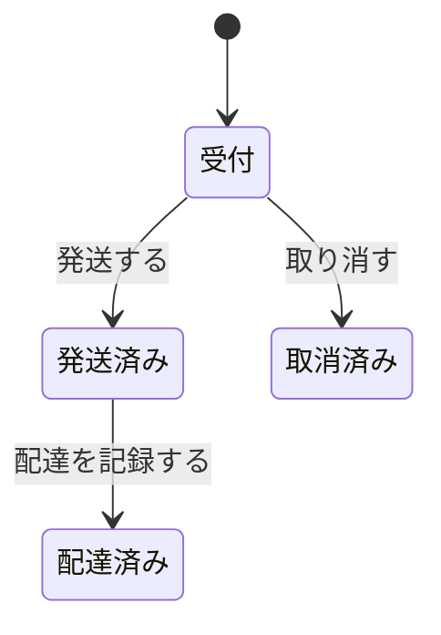

# 注文

## 要件

| ID | 内容 |
|---|---|
| REQ-10 | 注文を取り消せるのは発送前だけ |
| REQ-11 | 管理者は発送済みにできる |

## 注文の状態

## 権限

| 操作 | 管理者 | 一般会員 | ゲスト |
|---|---|---|---|
| 注文を取り消す | ○ | ○ | × |
| 発送済みにする | ○ | × | × |

## API

- `POST /orders/{id}/cancel` — 取り消す。200: 取り消した / 404: 注文がない / 409: 発送済み
